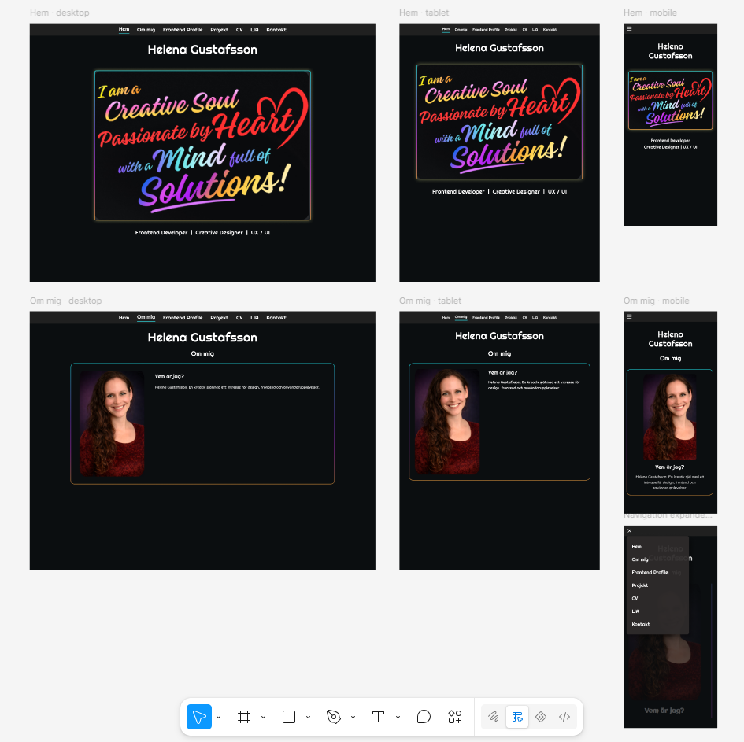
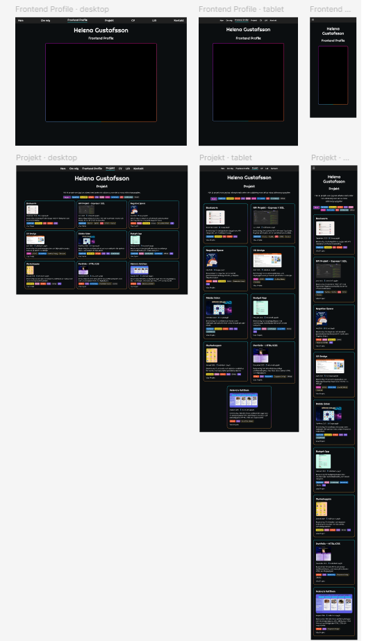
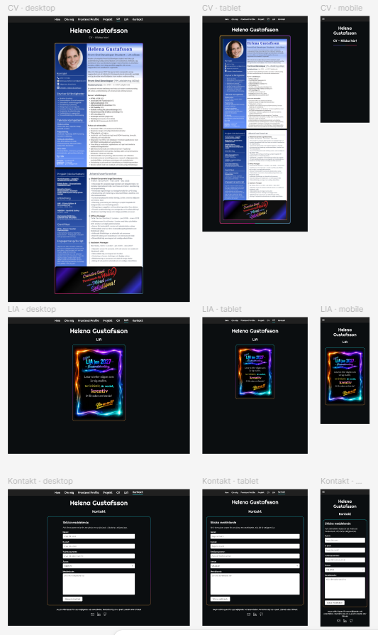

# Helena Gustafsson Portfolio

## 📝 About the Project
This portfolio was developed as part of the Front End Developer programme at Medieinstitutet.

The application is built as a Single Page Application (SPA) using React, TypeScript, Vite and CSS Modules. The purpose of the project was to create a personal portfolio that presents projects, technical skills and professional information while demonstrating modern frontend development techniques and best practices.

The portfolio contains the following sections:
* Home
* About Me
* Frontend Profile
* Projects
* CV
* LIA
* Contact

The project focuses on:
* Component-based architecture
* Reusable React components
* Responsive design
* State management
* Type safety with TypeScript
* Separation of concerns

---

## 🛠️ Tech Stack

 


### Tools & Services

* GitHub
* Figma
* Vercel

---

## ✨ Features

### Project Showcase
Projects are stored in a separate data source and rendered dynamically using React and array methods.

### Project Filtering
Projects can be filtered through technology badges using a multi-select filtering system built with React state and array methods.

Features include:
* Multiple selected filters
* Default "All" state
* Dynamic filtering using .filter()
* Automatic de-selection of "All" when one or more filters are selected

### Contact Form
The contact form is built using controlled inputs and includes:
* Name
* Email
* Phone
* Subject
* Message

Additional functionality:
* State-based validation
* Error handling through React state
* Success message on successful submission
* Dropdown-based subject selection

### Responsive Design
The application has been adapted for:
* Desktop
* Tablet
* Mobile

---

## 🎓 Learning Objectives
This project demonstrates knowledge of:
* React Components
* Props
* TypeScript
* useState
* Conditional Rendering
* Array Methods (map() and filter())
* Form Handling
* Form Validation
* Responsive Design
* CSS Modules
* Component-Based Architecture

---

## 🧠 Technical Implementation

### Dynamic Project Data
Project information is stored separately from the UI and rendered dynamically using .map().
Project IDs are generated automatically when the project data is mapped into the final project array.

### Filtering Logic
Filtering is calculated during rendering using .filter() rather than storing filtered results in a separate state.

### DRY Principle
Shared styling utilities were created to reduce code duplication.

Reusable utility classes include:
* NeonBorder
* NeonHover

These are reused across:
* Buttons
* Links
* Project badges
* Images

### Contact Form Validation
The contact form uses controlled inputs and state-driven validation with dedicated error handling and success messaging.

### Type Safety
TypeScript types are separated into dedicated type files to improve maintainability and ensure type-safe data structures throughout the application.

### State Management

React state is used to manage navigation, project filtering, contact form data, validation messages and other interactive UI elements throughout the application.

### Separation of Concerns

The project is structured using dedicated folders for components, sections, data, types and styles. This separation helps improve maintainability, readability and scalability.

---

## 📂 Project Structure

### Components
Reusable React components:
* Navbar
* NeonFrame
* ProjectCard
* ContactForm
* CreativeImage

### Sections
Page sections:
* Home
* About
* FrontendProfile
* Projects
* CV
* LIA
* Contact

### Data
Application data is separated from the UI:
* projectData
* badgesData

### Types
Dedicated TypeScript definitions:
* ProjectType
* ContactFormType

### Styling
The project uses CSS Modules for scoped and maintainable styling.

---

## 💻 Getting Started

Clone the repository:
```bash
git clone https://github.com/Helena-Gustafsson/Helena-Gustafsson-Portfolio-2026-React.git
```

Navigate to the project folder:
```bash
cd Helena-Gustafsson-Portfolio-2026-React
```

Install dependencies:
```bash
npm install
```

Start the development server:
```bash
npm run dev
```

Create a production build:
```bash
npm run build
```

---

## 🌐 Live Demo
Portfolio Website:
[View Live Portfolio](https://helena-gustafsson-portfolio-2026-re.vercel.app/)

### 📸 Final Application
*(Add screenshots of the completed portfolio)*

---

## 🎨 Design Process
The project was planned through written documentation and hand-drawn wireframes, which were later developed into digital designs in Figma.

The visual design uses:
* Dark user interface
* Neon-inspired accents
* Reusable UI components
* Responsive layouts
* Accessibility considerations

### Deviations from Figma Design
The final implementation follows the desktop, tablet and mobile wireframes quite closely. In my initial planning, there was an ambition to implement a bilingual Swedish/English (SV/EN) toggle, but I chose to design the wireframes without it and leave it as a feature to add if time permitted or future feature to add. Aside from minor adjustments to typography and layouts during development, the final application stays true to the original layout plan.

### Figma




---

## 📝 Reflection
One of the primary goals of this project was to create a maintainable and scalable portfolio application using reusable React components and a clear separation between data, logic and presentation.

Looking back at this project, I realized just how much the final result depended on all the time and effort I invested in the planning stage. I spent a lot of time mapping out exactly how I wanted the app to behave, ensuring that the navigation felt logical, unified, and user-friendly. A major focus for me was the responsive design, I worked incredibly hard to ensure the layout remains stable and looks clean across all device sizes and as soon as you added something new there was a domino effect and it needed constant re-adjusting and checking. Using CSS Modules correctly was key.  

My visual system also evolved dynamically during development. While I had planned the `NeonFrame` as a core reusable layout component from the very beginning, building out the pages made me notice unnecessary code repetition on other individual elements. To solve this, I created the shared utility styles `NeonBorder` and `NeonHover`. Integrating these later allowed me to clean up the code and apply a consistent, polished and resuable style across buttons, links, and badges without repeating myself. 

I also put a lot of thought into future-proofing the application. Instead of manually writing IDs for my projects, I set up a dynamic solution so that IDs are generated completely automatically. Whether I add a new project at the beginning, middle, or end of the data list in the future, they will always sequence themselves in the correct order. Building this portfolio step-by-step allowed me to turn my initial ideas into a dynamic interface that functions exactly the way I envisioned.

The project provided invaluable practical experience in:
* Planning a clean, highly organized folder and file structure, keeping components, dynamic data files, types, styles, and assets like images and PDFs cleanly separated.
* Structuring the application architecture around logical component views, state management, and clear boundaries between sections.
* Architecting a sustainable layout system, blending component-specific CSS Modules with global styles, shared variables, and custom theme layouts.
* Managing complex user flows, such as data filtering systems, and dynamic interface adjustments.

Particular focus was placed on maintainability, reusable components, responsive design across multiple breakpoints, and ensuring a consistent visual identity throughout the application.

### Future Expansion

The project structure was designed with future scalability in mind. Additional project information is already supported through the existing details property, allowing future expansion of project cards without modifying the overall data structure.

### Use of AI Tools
AI has been used in this project as a personal tutor and a technical sounding board. I have utilized it to ask conceptual questions when implementing features not yet fully covered in class, and to double-check that my architectural plans for components and state management were correct and well-thought-out. 

Furthermore, I have actively challenged the AI when receiving suboptimal or incorrect answers, proving my own understanding of React by explaining why a different approach was necessary until the correct solution was achieved. AI was also used efficiently to format and compile longer datasets and texts based on my direct inputs to save development time.

---

## 📘 Developer
Helena Gustafsson
* [GitHub link](https://github.com/Helena-Gustafsson)
* [LinkedIn Profile](https://www.linkedin.com/in/helena-gustafsson-46926852/)
