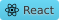

# Helena Gustafsson Portfolio

## 📝 About the Project
This portfolio was developed as part of the Front End Developer programme at Medieinstitutet.

The application is built as a Single Page Application (SPA) using React, TypeScript, Vite and CSS Modules. The purpose of the project was to create a personal portfolio that presents projects, technical skills and professional information while demonstrating modern frontend development techniques and best practices.

The portfolio contains the following sections:
* Home
* About Me
* Frontend Profile
* Projects
* CV
* LIA
* Contact

The project focuses on:
* Component-based architecture
* Reusable React components
* Responsive design
* State management
* Type safety with TypeScript
* Separation of concerns

---

## 🛠️ Tech Stack

 


### Tools & Services

* GitHub
* Figma
* Vercel

---

## ✨ Features

### Project Showcase
Projects are stored in a separate data source and rendered dynamically using React and array methods.

### Project Filtering
Projects can be filtered through technology badges using a multi-select filtering system built with React state and array methods.

Features include:
* Multiple selected filters
* Default "All" state
* Dynamic filtering using .filter()
* Automatic de-selection of "All" when one or more filters are selected

### Contact Form
The contact form is built using controlled inputs and includes:
* Name
* Email
* Phone
* Subject
* Message

Additional functionality:
* State-based validation
* Error handling through React state
* Success message on successful submission
* Dropdown-based subject selection

### Responsive Design
The application has been adapted for:
* Desktop
* Tablet
* Mobile

---

## 🎓 Learning Objectives
This project demonstrates knowledge of:
* React Components
* Props
* TypeScript
* useState
* Conditional Rendering
* Array Methods (map() and filter())
* Form Handling
* Form Validation
* Responsive Design
* CSS Modules
* Component-Based Architecture

---

## 🧠 Technical Implementation

### Dynamic Project Data
Project information is stored separately from the UI and rendered dynamically using .map().
Project IDs are generated automatically when the project data is mapped into the final project array.

### Filtering Logic
Filtering is calculated during rendering using .filter() rather than storing filtered results in a separate state.

### DRY Principle
Shared styling utilities were created to reduce code duplication.

Reusable utility classes include:
* NeonBorder
* NeonHover

These are reused across:
* Buttons
* Links
* Project badges
* Images

### Contact Form Validation
The contact form uses controlled inputs and state-driven validation with dedicated error handling and success messaging.

### Type Safety
TypeScript types are separated into dedicated type files to improve maintainability and ensure type-safe data structures throughout the application.

### State Management

React state is used to manage navigation, project filtering, contact form data, validation messages and other interactive UI elements throughout the application.

### Separation of Concerns

The project is structured using dedicated folders for components, sections, data, types and styles. This separation helps improve maintainability, readability and scalability.

---

## 📂 Project Structure

### Components
Reusable React components:
* Navbar
* NeonFrame
* ProjectCard
* ContactForm
* CreativeImage

### Sections
Page sections:
* Home
* About
* FrontendProfile
* Projects
* CV
* LIA
* Contact

### Data
Application data is separated from the UI:
* projectData
* badgesData

### Types
Dedicated TypeScript definitions:
* ProjectType
* ContactFormType

### Styling
The project uses CSS Modules for scoped and maintainable styling.

---

## 💻 Getting Started

Clone the repository:
```bash
git clone https://github.com/Helena-Gustafsson/Helena-Gustafsson-Portfolio-2026-React.git
```

Navigate to the project folder:
```bash
cd Helena-Gustafsson-Portfolio-2026-React
```

Install dependencies:
```bash
npm install
```

Start the development server:
```bash
npm run dev
```

Create a production build:
```bash
npm run build
```

---

## 🌐 Live Demo
Portfolio Website:
[View Live Portfolio](https://helena-gustafsson-portfolio-2026-re.vercel.app/)

---

## 🎨 Design Process
The project was planned through written documentation and hand-drawn wireframes, which were later developed into digital designs in Figma.

The visual design uses:
* Dark user interface
* Neon-inspired accents
* Reusable UI components
* Responsive layouts
* Accessibility considerations

### Figma
*(Add desktop, laptop and mobile figma screenshots)*

### Final Application
*(Add screenshots of the completed portfolio)*

---

## 📝 Reflection
One of the primary goals of this project was to create a maintainable and scalable portfolio application using reusable React components and a clear separation between data, logic and presentation.

Project data is stored separately from the UI and rendered dynamically through reusable components. The filtering functionality is calculated during rendering instead of storing filtered results in state.

The project provided practical experience working with:
* React
* TypeScript
* State Management
* Form Validation
* CSS Modules
* Responsive Design
* Component Architecture

Particular focus was placed on maintainability, reusable components, responsive design across multiple breakpoints, and ensuring a consistent visual identity throughout the application.

### Future Expansion

The project structure was designed with future scalability in mind. Additional project information is already supported through the existing details property, allowing future expansion of project cards without modifying the overall data structure.

---

## 👤 Author
Helena Gustafsson
* [GitHub link](https://github.com/Helena-Gustafsson)
* [LinkedIn Profile](https://www.linkedin.com/in/helena-gustafsson-46926852/)
